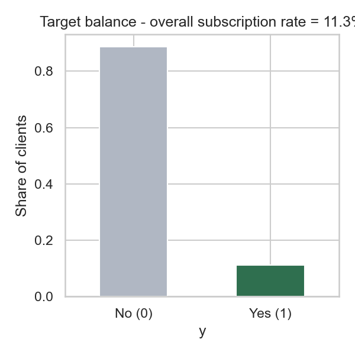
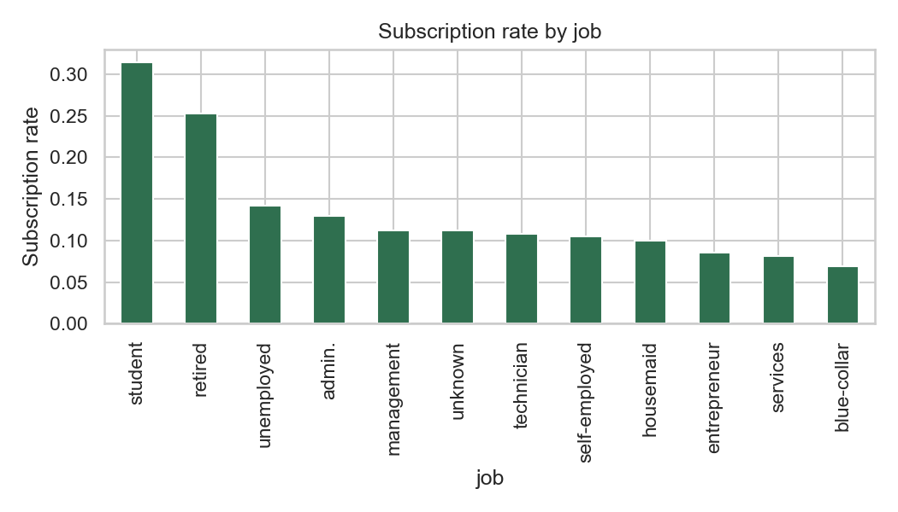
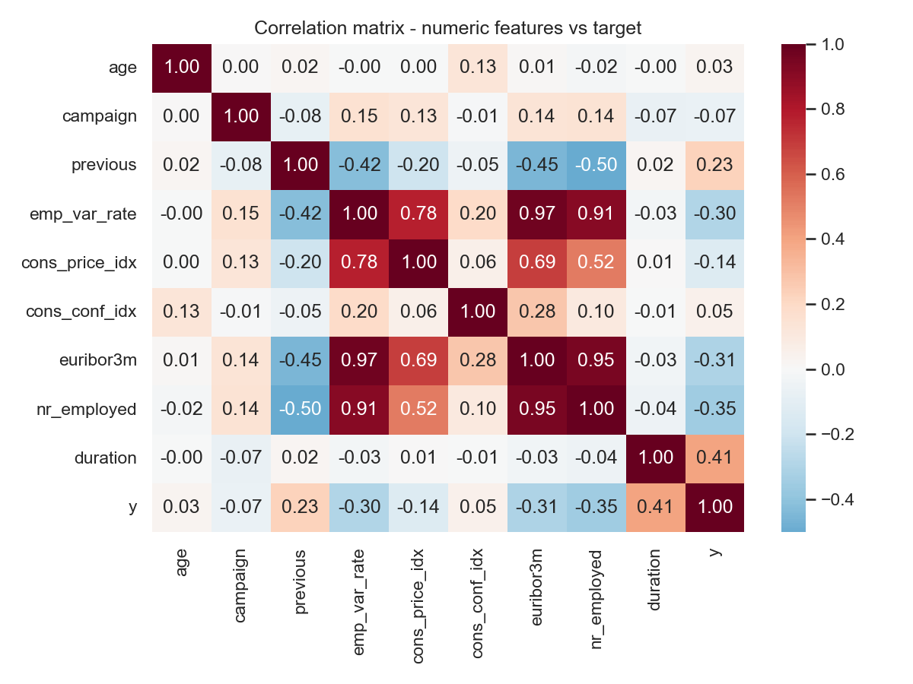
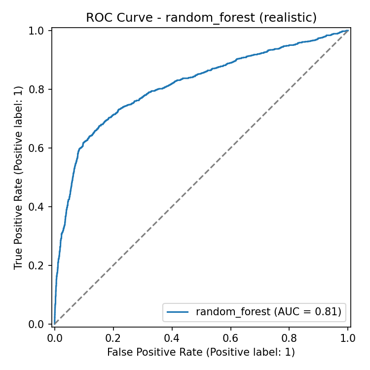
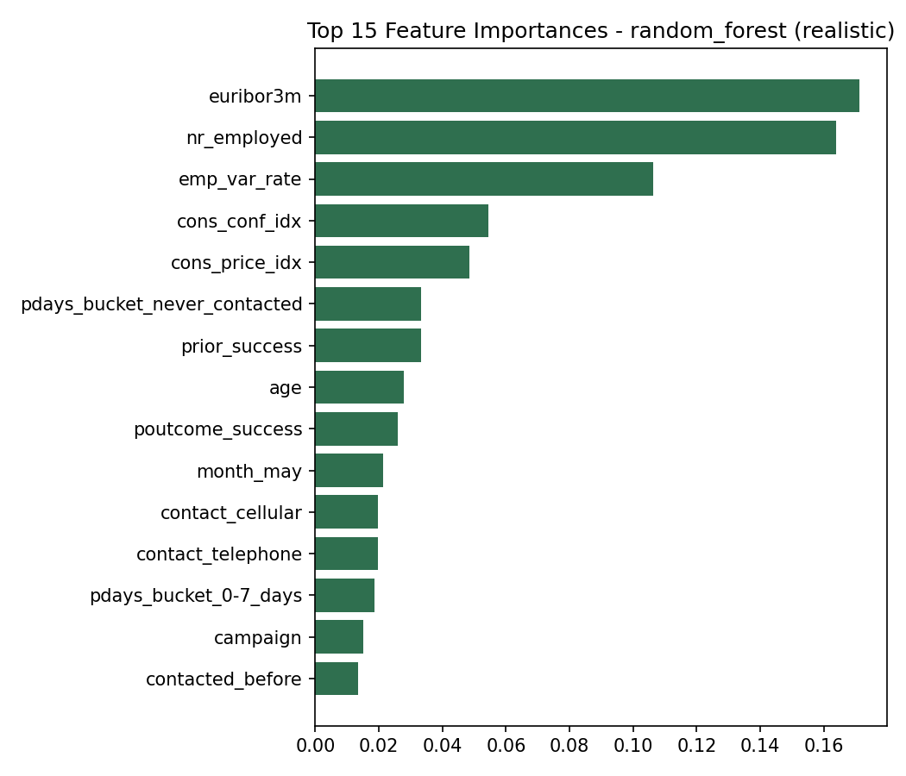

# Marketing Analytics: Predicting Term Deposit Subscription

An end-to-end marketing analytics project on a real bank telemarketing
campaign: data cleaning, feature engineering, exploratory analysis,
statistical hypothesis testing, a propensity-to-subscribe classification
model, SQL-based campaign reporting, and a Power BI dashboard design built
on top. The goal mirrors a real marketing-ops ask: **which clients should
we call next, and why**.

Built with **Python, SQL, and R only** - no other languages are used
anywhere in the pipeline.

---

## Table of contents

- [Business problem](#business-problem)
- [Dataset](#dataset)
- [Tech stack](#tech-stack)
- [Project structure](#project-structure)
- [Methodology](#methodology)
- [Key findings](#key-findings)
- [Model performance](#model-performance)
- [Power BI dashboard](#power-bi-dashboard)
- [How to reproduce](#how-to-reproduce)
- [License](#license)
- [Citation & acknowledgments](#citation--acknowledgments)

---

## Business problem

A Portuguese retail bank ran a series of outbound telemarketing campaigns
(May 2008 - Nov 2010) offering clients a term deposit product. Only
**~11.3%** of contacted clients subscribed. Calling everyone is expensive
and calling nobody wastes an engaged customer base. This project answers
three questions a marketing analytics team would actually be asked:

1. **What drives conversion?** (demographics, contact channel, timing,
   prior campaign history, macro-economic conditions)
2. **Can we predict, before dialing, which clients are worth calling?**
3. **How do we operationalize that** as a reporting/BI layer the marketing
   team can actually use day to day?

## Dataset

**Bank Marketing (with social/economic context)**, UCI Machine Learning
Repository - also mirrored on Kaggle as
["Bank Marketing Dataset"](https://www.kaggle.com/datasets/henriqueyamahata/bank-marketing).

- **Original source (downloaded from):** https://archive.ics.uci.edu/dataset/222/bank+marketing
- **Kaggle mirror:** https://www.kaggle.com/datasets/henriqueyamahata/bank-marketing
- **File used:** `bank-additional-full.csv` (41,188 rows, 20 input features + target), the full version enriched with 5 macro-economic indicators
- **License/terms:** released by the authors as public for research use
- **Citation:**
  > S. Moro, P. Cortez and P. Rita. *A Data-Driven Approach to Predict the Success of Bank Telemarketing.* Decision Support Systems, Elsevier, 62:22-31, June 2014. https://doi.org/10.1016/j.dss.2014.03.001

Raw data and the original data dictionary are committed under
[`data/raw/`](data/raw/) for full reproducibility. Target variable `y`:
whether the client subscribed to a term deposit (`yes`/`no`).

> **Leakage warning (documented by the original authors, respected throughout this project):** the `duration` field (last call length) is only known *after* the call ends and is near-perfectly correlated with the outcome. It is reported as a literature **benchmark** feature set for comparison only; every actionable model and the Power BI "propensity" score are built on the **realistic** feature set that excludes it. See [Model performance](#model-performance).

## Tech stack

| Layer | Language | Libraries / tools |
|---|---|---|
| Data cleaning, feature engineering, EDA, modeling | **Python 3.9** | `pandas` 2.3, `numpy` 2.0, `scikit-learn` 1.6, `matplotlib` 3.9, `seaborn` 0.13, `statsmodels` 0.14, `joblib`, `nbformat`/`nbconvert` (notebook generation & execution) |
| Campaign reporting & aggregation | **SQL** | SQLite 3 (`sql/`) |
| Statistical hypothesis testing & inferential plots | **R** | `readr`, `dplyr`, `ggplot2`, `broom` |
| Dashboard | **Power BI** | Star-schema CSV export + DAX (see [powerbi/](powerbi/)) |

Exact pinned versions are in [`requirements.txt`](requirements.txt).

## Project structure

```
marketing-analytics/
├── data/
│   ├── raw/                        UCI source CSV + original data dictionary
│   └── processed/                  Cleaned & feature-engineered CSVs, SQLite DB
├── src/                            Reusable Python pipeline modules
│   ├── data_cleaning.py
│   ├── feature_engineering.py
│   ├── modeling.py
│   └── export_powerbi.py
├── notebooks/                      Executed Jupyter notebooks (charts included)
│   ├── 01_eda.ipynb
│   ├── 02_feature_engineering.ipynb
│   └── 03_modeling.ipynb
├── scripts/
│   └── build_notebooks.py          Builds + executes the notebooks reproducibly
├── sql/                            SQLite schema, loader, and analysis queries
│   ├── schema.sql
│   ├── load_db.py
│   └── campaign_analysis.sql
├── r/
│   └── statistical_analysis.R      Chi-square, t-test, ANOVA, logistic regression
├── powerbi/
│   ├── README.md                   Dashboard build guide + DAX measures
│   └── data/                       Star-schema CSVs (fact + date dimension)
├── reports/
│   ├── figures/                    EDA & model evaluation charts (Python)
│   ├── r_outputs/                  Statistical test results & charts (R)
│   ├── sql_query_results.txt       Saved output of sql/campaign_analysis.sql
│   └── metrics.json                Model comparison metrics
├── models/
│   └── best_model_realistic.joblib Trained propensity model
├── requirements.txt
├── LICENSE
└── README.md
```

## Methodology

1. **Cleaning** ([`src/data_cleaning.py`](src/data_cleaning.py)): dedupe
   (12 exact duplicate rows dropped), dtype normalization, and an explicit
   data-quality report (missing/`unknown` counts per column, target base
   rate) rather than silently dropping "unknown" categorical values -
   they are informative (e.g. undisclosed loan status skews toward
   non-subscribers) and kept as their own category.
2. **Feature engineering** ([`src/feature_engineering.py`](src/feature_engineering.py)):
   age bands, campaign-contact-count buckets, a `pdays` recency bucket
   that correctly treats the `999` "never contacted" sentinel as a
   category rather than a numeric distance, quarter-of-year seasonality,
   and behavioral flags (`contacted_before`, `prior_success`) distilled
   from raw contact history.
3. **EDA** ([`notebooks/01_eda.ipynb`](notebooks/01_eda.ipynb)): target
   imbalance, univariate conversion-rate breakdowns, correlation
   structure among the macro-economic indicators.
4. **Modeling** ([`notebooks/03_modeling.ipynb`](notebooks/03_modeling.ipynb),
   [`src/modeling.py`](src/modeling.py)): Logistic Regression, Random
   Forest, and Gradient Boosting compared on both the leakage-free
   "realistic" feature set and a literature "benchmark" set, evaluated on
   ROC-AUC, PR-AUC, and positive-class recall (accuracy is misleading at
   an 11% base rate).
5. **SQL campaign reporting** ([`sql/campaign_analysis.sql`](sql/campaign_analysis.sql)):
   the same questions a marketing analyst would ask in a BI tool -
   conversion by segment, channel, recency, and prior outcome - run
   directly against a SQLite database built from the modeled data
   ([`sql/load_db.py`](sql/load_db.py)).
6. **Statistical validation** ([`r/statistical_analysis.R`](r/statistical_analysis.R)):
   formal hypothesis tests (chi-square, Welch t-test, ANOVA) confirming
   the EDA patterns aren't noise, plus an interpretable logistic
   regression reported as odds ratios.
7. **Power BI dashboard** ([`powerbi/`](powerbi/)): a star schema (fact +
   date dimension) exported from the modeled data, model-scored
   propensity per contact, and a full DAX/visual build guide.

## Key findings

Full output: [`reports/sql_query_results.txt`](reports/sql_query_results.txt) · [`reports/r_outputs/statistical_tests_summary.txt`](reports/r_outputs/statistical_tests_summary.txt)

- **Prior engagement beats everything.** Clients with a successful prior
  campaign outcome convert at **65.1%**, vs. **8.8%** for clients never
  previously contacted (chi-square p < 2.2e-16) - by far the strongest
  signal in the data, and the top feature in every model.
- **Under-targeted high-value segments.** Students (**31.4%** conversion)
  and retirees (**25.3%**) convert 2-3x the overall average yet make up
  only ~2% and ~4% of contacts respectively - a clear reallocation
  opportunity (chi-square p < 2.2e-16 on job).
- **Diminishing, then negative, returns from repeated calling.** Conversion
  drops monotonically from **13.0%** (1st contact) to **4.6%** (7+
  contacts this campaign) - a cap-frequency-per-client policy is directly
  supported by the data.
- **Cellular outperforms landline.** 14.7% vs. 5.2% conversion by contact
  channel - channel selection alone is a ~3x lever.
- **Seasonality is real and economically driven.** Conversion swings from
  ~6% in May to 45-50% in Mar/Sep/Oct/Dec; a one-way ANOVA confirms the
  macro-economic indicators (e.g. Euribor 3-month rate) differ
  significantly by quarter (F = 1721, p < 2.2e-16) and Euribor itself
  carries an odds ratio of 0.70 per unit in the logistic model - cheaper
  money makes term deposits a harder sell.
- **Recency matters more than frequency.** Clients last contacted 0-7 days
  ago convert at 65.8%, decaying toward the 9.3% baseline as the gap
  since last contact grows.

 



## Model performance

Full table: [`reports/metrics.json`](reports/metrics.json)

| Feature set | Model | ROC-AUC | PR-AUC | Recall (subscribed) |
|---|---|---|---|---|
| Realistic (no `duration`) | Logistic Regression | 0.800 | 0.444 | 0.651 |
| Realistic (no `duration`) | **Random Forest (selected)** | **0.813** | 0.477 | 0.625 |
| Realistic (no `duration`) | Gradient Boosting | 0.809 | 0.481 | 0.230 |
| Benchmark (incl. `duration`) | Logistic Regression | 0.940 | 0.594 | 0.904 |
| Benchmark (incl. `duration`) | Random Forest | 0.944 | 0.640 | 0.915 |
| Benchmark (incl. `duration`) | Gradient Boosting | 0.949 | 0.659 | 0.545 |

The **Random Forest on the realistic feature set** is the deployable model
(saved to `models/best_model_realistic.joblib`) - it only uses information
available *before* a call is placed, so it can actually rank tomorrow's
call list. The benchmark numbers (~0.94-0.95 ROC-AUC) match the original
paper's published range and exist here purely as a sanity check that the
pipeline is correct.

 

## Power BI dashboard

The full dashboard build guide - data model, DAX measures, and
page-by-page visual spec - is in [`powerbi/README.md`](powerbi/README.md).

**Why there's no `.pbix` file in this repo:** Power BI Desktop is a Windows
GUI application with no command-line or headless build mode, and this
project was built in a macOS/CLI environment, so a `.pbix` could not be
authored or executed here. Instead, `powerbi/data/` contains a ready-to-load
star schema (fact table with model-scored propensity per contact, plus a
date dimension) and `powerbi/README.md` gives the exact steps, relationships,
and DAX to build the real dashboard in Power BI Desktop in ~10-15 minutes.
The same CSVs work in Excel PivotTables or Tableau if you'd rather skip
Power BI Desktop entirely.

## How to reproduce

```bash
# 1. Python environment
python3 -m venv .venv
source .venv/bin/activate        # Windows: .venv\Scripts\activate
pip install -r requirements.txt

# 2. Run the pipeline
python -m src.data_cleaning
python -m src.feature_engineering
python -m src.modeling
python -m src.export_powerbi

# 3. Rebuild the executed notebooks
python scripts/build_notebooks.py

# 4. SQL campaign reporting (SQLite - no server needed)
python sql/load_db.py
sqlite3 -header -column data/processed/marketing_analytics.db < sql/campaign_analysis.sql

# 5. R statistical analysis (installs readr/dplyr/ggplot2/broom on first run)
Rscript r/statistical_analysis.R
```

Then open `powerbi/data/*.csv` in Power BI Desktop and follow
[`powerbi/README.md`](powerbi/README.md).

## License

Code and original written content: [MIT](LICENSE).
The bundled dataset retains its original UCI/Kaggle terms - see
[Dataset](#dataset) and the note at the bottom of the [LICENSE](LICENSE) file.

## Citation & acknowledgments

> S. Moro, P. Cortez and P. Rita. *A Data-Driven Approach to Predict the Success of Bank Telemarketing.* Decision Support Systems, Elsevier, 62:22-31, June 2014.

Dataset: [UCI Machine Learning Repository - Bank Marketing](https://archive.ics.uci.edu/dataset/222/bank+marketing) · [Kaggle mirror](https://www.kaggle.com/datasets/henriqueyamahata/bank-marketing)

---

Built by [Kuladeep Roy](https://github.com/kdeepr).
